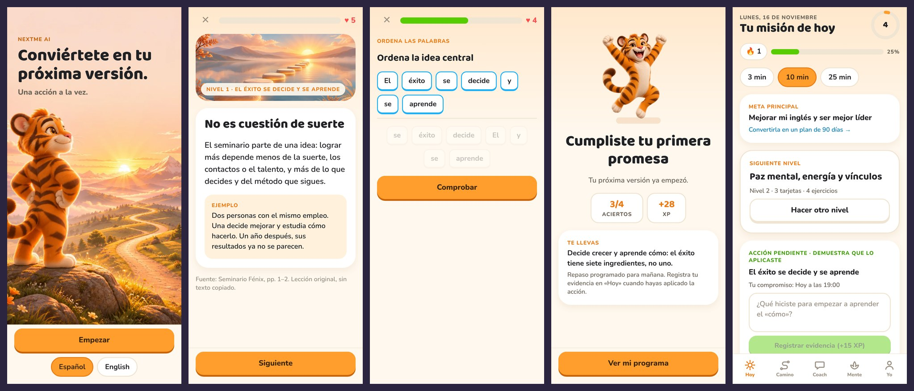
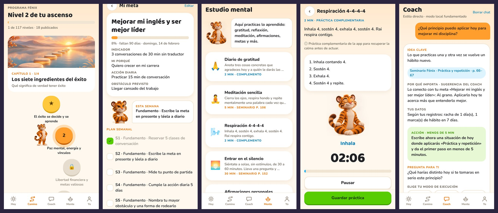
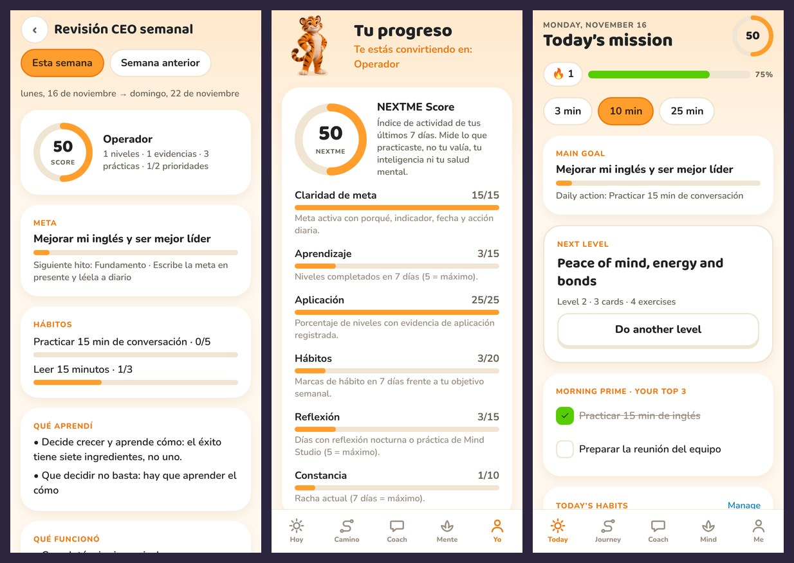

# NEXTME AI

**Become your next self. One action at a time.**
App móvil (iOS · Android · web) que convierte los principios del Seminario Fénix en lecciones de 3 minutos, acciones diarias, hábitos, prácticas y resultados medibles. Español primero, inglés completo.





## Qué hace hoy (verificado)

| Área | Estado |
|---|---|
| Onboarding conversacional sin registro → primer nivel | ✅ |
| Reproductor de niveles: tarjetas → 4 minijuegos (+ escenario) → reflexión → acción personalizada | ✅ |
| Programa Fénix: **117 niveles** mapeados a páginas; **18 jugables** redactados a mano; 99 en plano | ✅ / 📝 |
| Evidencia de aplicación (PROVE) y repaso espaciado 1-3-7-14-30 días | ✅ |
| Hoy: Morning Prime, lección, acción pendiente, hábitos, reflexión nocturna, sesiones de 3/10/25 min | ✅ |
| Arquitecto de metas: plan de 90 días editable y aprobable | ✅ |
| Mind Studio: 14 prácticas (gratitud, meditación, silencio, afirmaciones, visualización, preocupaciones, 7 preguntas, 20 ideas, perdón…) | ✅ |
| Coach fundamentado con cita de página, modos 2/10/25, bóveda personal | ✅ local · ☁️ nube sin desplegar |
| Revisión CEO semanal, Future Self, NEXTME Score transparente | ✅ |
| Exportar / eliminar datos, consentimiento de memoria, ES/EN | ✅ |
| Backend Supabase (esquema + RLS + funciones de IA) | ✅ SQL probado · funciones sin desplegar |

Detalle y límites: [docs/QUALITY_REPORT.md](docs/QUALITY_REPORT.md).

## Empezar

```bash
npm install
npm run web          # navegador
npm run ios          # o: npm run android  (Expo Go o development build)
```

No necesita cuentas ni claves: funciona 100 % en el dispositivo. La nube es opcional (`.env.example`).

## Comprobaciones

```bash
npm run typecheck    # TypeScript estricto
npm test             # 57 pruebas: lógica + validación de contenido
npm run e2e          # compila web y recorre el flujo real en Chromium (18 pasos)
npm run test:db      # migración + 18 pruebas de Row Level Security (necesita Postgres local)
npm run docs:matrix  # regenera la matriz de cobertura del seminario
```

## Documentación

| Entregable | Archivo |
|---|---|
| Matriz del Seminario Fénix (conceptos → páginas → niveles) | [docs/SOURCE_INTELLIGENCE.md](docs/SOURCE_INTELLIGENCE.md) |
| Especificación de producto y decisiones | [docs/PRODUCT_SPEC.md](docs/PRODUCT_SPEC.md) |
| Sistema de diseño | [docs/DESIGN_SYSTEM.md](docs/DESIGN_SYSTEM.md) |
| Biblioteca de activos Higgsfield | [docs/ASSET_LIBRARY.md](docs/ASSET_LIBRARY.md) |
| Sistema de IA (RAG, coach, generador) | [docs/AI_SYSTEM.md](docs/AI_SYSTEM.md) |
| Informe de calidad | [docs/QUALITY_REPORT.md](docs/QUALITY_REPORT.md) |
| Guía de despliegue | [docs/DEPLOYMENT.md](docs/DEPLOYMENT.md) |

## Estructura

```
src/app/            pantallas (Expo Router): onboarding, (tabs) hoy·camino·coach·mente·yo, level, goal, habits…
src/components/     UI reutilizable, Rai, minijuegos
src/content/        currículo, niveles redactados, prácticas, arte
src/lib/            estado persistente, puntaje, repaso, coach (RAG local), metas, revisión, validador
src/theme/          tokens de diseño
supabase/           migración SQL (RLS) y Edge Functions: coach, generate-level, ingest
scripts/            CLI de contenido, e2e, prueba de migración
tests/              pruebas unitarias y de contenido
```

## Contenido y derechos

Las lecciones son texto **original** que parafrasea ideas del seminario; cada una guarda sus páginas de origen para trazabilidad. La transcripción **no** está en el repositorio ni en la app. Antes de comercializar contenido derivado del seminario, verifica los derechos correspondientes.

NEXTME AI es una herramienta educativa. No ofrece diagnóstico ni tratamiento médico o psicológico, ni asesoría financiera, y no garantiza resultados.
